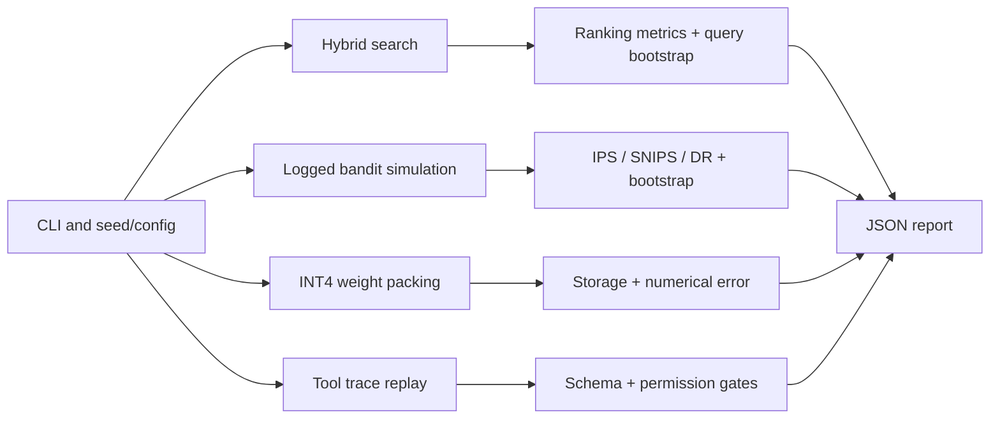

# System architecture

The modules intentionally separate data simulation, model/policy logic, evaluation, and user-facing reports.

## Module boundaries

- `retrieval.py` owns lexical and low-rank indexing and RRF, and is reusable independently of the demo corpus.
- `ranking_metrics.py` is agnostic to the ranking model, allowing direct baseline comparisons.
- `statistics.py` resamples paired query-level differences, not raw documents.
- `bandits.py` maintains distinct logging-policy, reward-model, target-policy, and evaluation steps.
- `quantization.py` keeps storage representation distinct from transient CPU dequantization.
- `agent_eval.py` validates declared tools and produces an auditable, side-effect-free replay summary.
- `sweeps.py` holds evaluation scenarios so experiments use fixed inputs for fair comparisons.

The intentionally small codebase is suitable for experimenting on a laptop. Scaling to real ML systems would require dataset lifecycle controls, streaming I/O, accelerated compute, serving endpoints, deployment observability, and security review.
